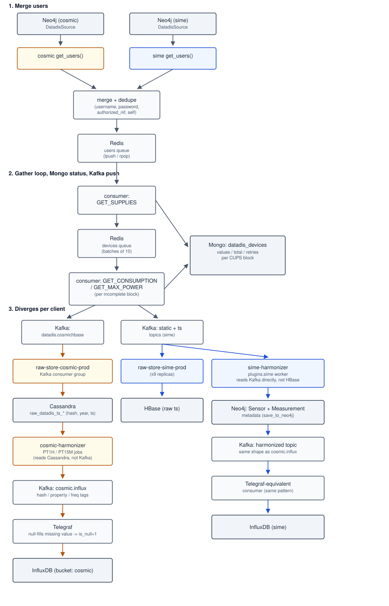

# Datadis description
This module will import data from Datadis and harmonize it from different sources.

The following image depicts the workflow of the script: users are pulled from each plugin's own Neo4j and merged into
one Redis-queued gather loop backed by Mongo status tracking, then the raw Kafka output forks into two differently-built
per-client paths - cosmic's sequential Cassandra-then-harmonizer chain, and sime's parallel fan-out where the harmonizer
reads Kafka directly instead of its own HBase raw store.



Each plugin consists on the configuration of a project source. The datadis users and authorized users will be obtained 
following the plugin schema. After that, the users will be aggregated together by source depending on the configuration. 
This is done to avoid connecting to the same users more than once. Only sources with the correct user/password will get the data.
then the distributed process of getting the different user CUPS and CUPS data is performed.

## Gather data

The data gathering process consists of a set of plugins that collect users and passwords from multiple databases and 
store them in a Redis queue. This queue is then processed to retrieve the devices assigned to each user, which are 
uploaded into another Redis instance. Finally, the second queue, containing user-device mappings, is processed to 
extract the data from each device.

###### Howto
The data gathering process consists of a two-step application:

### 1. Producer  
The producer collects user data and can be started with the following command:

```bash
python3 launcher.py -p last -l producer
```
### 2. Consumer  
The consumers process the user queue, generate a new devices queue, process it, and retrieve data from the devices. 
And send it to the corresponding TOPIC:
- Timeseries: topic defined in the source plugin
- Static: datadis.harm topic (defined in settings.py)

you can start the consumers with:
```bash
python3 launcher.py -p last -l consumer
```

### Retries and plateau detection

Each CUPS' progress is tracked in Mongo as a set of date-range "blocks" (per `data_1h`, `data_15m` and
`max_power`), each holding `values`/`total`/`retries`/`stale_attempts`. Two independent mechanisms decide
whether an incomplete block is attempted again on the next consumer run:

- **`retries`**: decremented only when an attempt returns zero new rows. Once it reaches 0, the block is
  exhausted and never attempted again - this is the right behavior for a supply that genuinely has no data
  for that range (e.g. it didn't exist yet).
- **`stale_attempts`**: increments when an attempt returns data but doesn't improve on the previous attempt's
  `values` count, and resets to 0 the moment an attempt does improve. Once it reaches `MAX_STALE_ATTEMPTS`
  (6 consecutive non-improving attempts), the block is treated as **plateaued** and excluded from further
  retries - independently of `retries`, which a partially-successful attempt never touches.

This distinguishes a block that's still genuinely catching up (`stale_attempts` kept resetting) from one
that's permanently stuck a few rows short (e.g. a real one-off outage leaving a small gap) and would
otherwise be retried forever with no way to stop. Both states are surfaced in `tools/check_mongo_cups.py`
(per-CUPS status, marked `PLATEAUED (given up)`) and reported as separate counts in the daily Discord
healthcheck (`tools/check_gather_health.py`).

## Harmonize data

To harmonize the gathered data, each source will need to implement their own harmonizer.

## Deploy in production

To deploy in production, we need to dockerize the project using the included Dockerfile


Using the Kubernetes YAML configurations included in `kubeconfigs`, deploy the project to the cluster:
```bash
kubectl apply -f kubeconfigs/services.yaml 
```
Create any required harmonizer from the plugins (read their documentation)

Create the required secrets:
```bash
#basic secret
kubectl create secret generic datadis-base-secret --from-file=config.json=config.json -n datadis
kubectl create secret generic datadis-plugins-secret --from-file=config_plugin_x.json=config_plugin_x.json --from-file=config_plugin_y.json=config_plugin_y.json -n datadis

```
